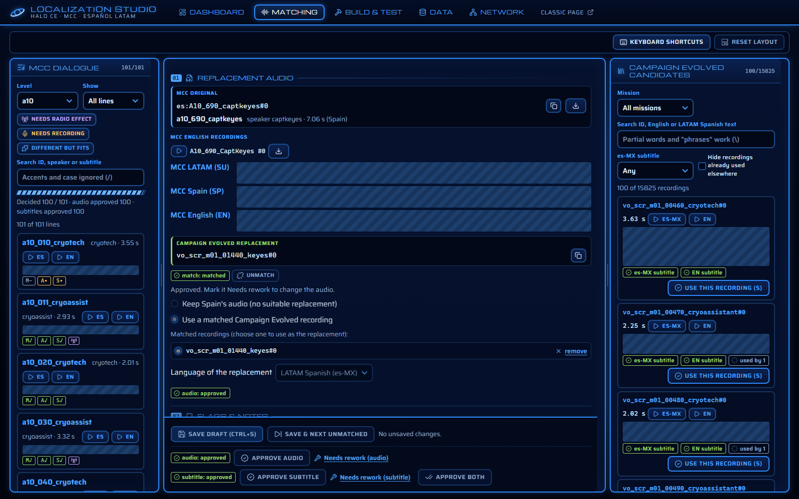
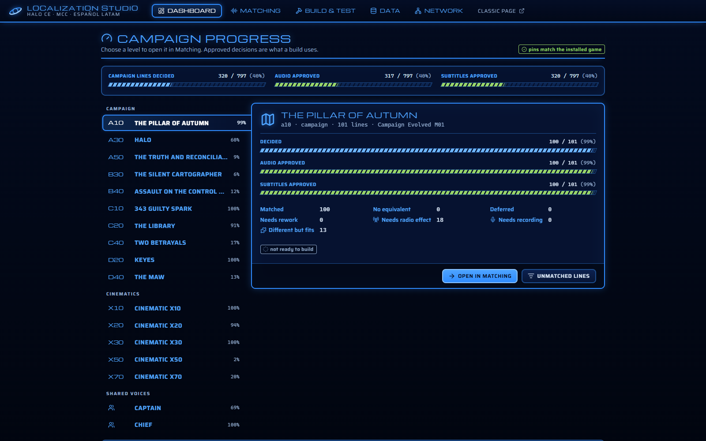
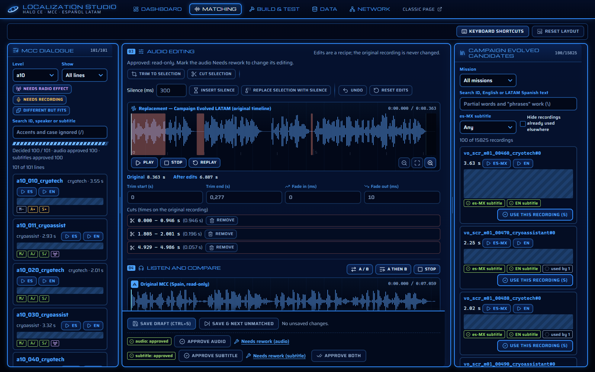
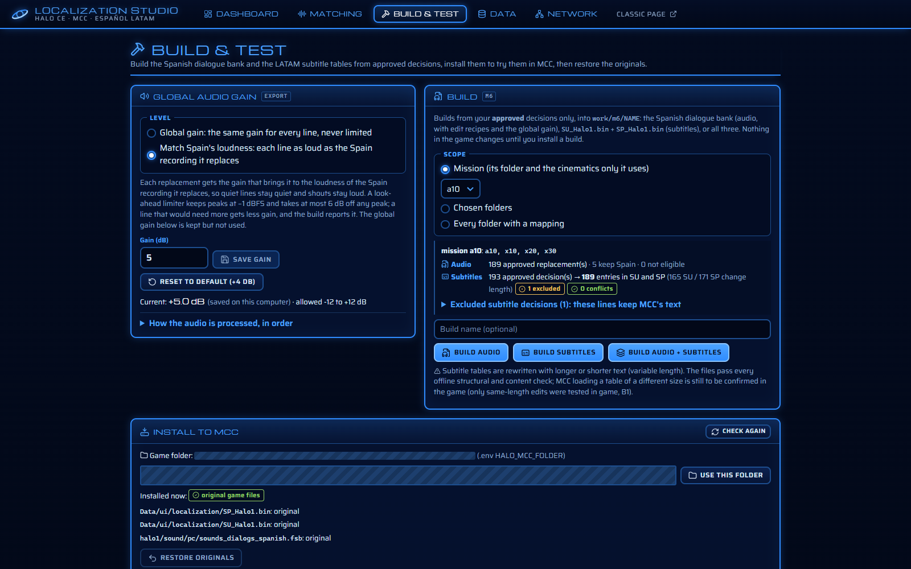

# Halo CE — Latin American Spanish dub for MCC

A mod project that gives *Halo: Combat Evolved* in *Halo: The Master Chief Collection* (MCC) a **Latin American
Spanish** voice track and subtitles.

MCC ships Halo CE's dialogue in Spain's Spanish only. Its "Spanish (Latin America)" option translates the
interface but keeps Spain's voices. *Halo: Campaign Evolved* (CE, 2026) has a full Mexican Spanish (es-MX)
dub with subtitles. This project replaces, line by line, what MCC plays and shows when Spanish is selected:

- **Audio:** each Spain recording in MCC's Spanish dialogue bank (`sounds_dialogs_spanish.fsb`) can be replaced
  by a CE es-MX recording, or kept as it is.
- **Subtitles:** each line's text in MCC's subtitle tables (`SU_Halo1.bin` for Latin America, `SP_Halo1.bin`
  for Spain) can be replaced by CE's es-MX subtitle or by your own text, or kept as it is.

The two games number their lines differently, so no tool can pair them reliably. Every pairing is made **by
hand** in the **Localization Studio**, this repository's matching tool. The rest of the pipeline turns the
approved pairings into game files and installs them in a way you can undo.



*Screenshots are made with `npm run docs:screenshots` on a throw-away copy of the data. Dialogue text and local
paths are hidden: game text is never committed.*

## Status

| Part | State |
|---|---|
| Replacing a line's audio in MCC | **Works in game.** CE es-MX lines encoded by this project play in MCC, and full-level builds have been installed and played. |
| Replacing subtitles in MCC | Same-length edits **work in game**. Tables rewritten with text of a different length pass every offline check but have not been loaded by MCC yet. |
| Matching (the Studio) | In use. About 40% of the campaign's lines are decided: *The Pillar of Autumn*, *343 Guilty Spark*, *Keyes* and several cinematics are done or nearly done. |
| Radio effect on replaced lines | Planned for v1.1. Lines can be flagged now; no processing is applied. |
| Release | **Local only.** A Steam Workshop release is planned but blocked on rights: MCC's modding FAQ allows only assets from MCC itself. See [docs/roadmap.md](docs/roadmap.md). |

You need your own copies of both games. This project only reads the installed files; it changes the game only
when you install a build from the Studio, and it backs up every original first.

## How it works

```
 Campaign Evolved (UE5)           MCC (Halo CE)
 es-MX recordings + subtitles     Spanish dialogue bank + SU/SP subtitle tables
          │                                 │
          └──── catalogs (work/, read-only) ┘
                         │
                Localization Studio ── you match, edit and approve each line
                         │
                mappings/  (your decisions, the only cross-game link)
                         │
                Build ── new Spanish bank and subtitle tables, from approved decisions only
                         │
                Install ── back up, copy, verify ── play MCC ── Restore
```

1. **Catalogs.** Scripts read both games and list every dialogue line: 1,903 MCC dialogue tags with 5,696
   Spanish recordings, and every CE line with its es-MX audio and subtitle. They never pair lines across games.
2. **Matching.** In the Studio you choose, for each MCC line, a CE recording (or keep Spain's), trim and edit
   it, choose its subtitle, and approve the audio and the subtitle separately.
3. **Build.** A build re-encodes the approved recordings in the game's own codec (CELT, as FMOD 4 expects it),
   writes them into a copy of the Spanish bank, and rewrites the approved subtitle entries. Every other byte
   stays MCC's.
4. **Install and restore.** The installer backs up and verifies the originals, copies the build, and restores
   everything with one click.

The research behind each step is in [docs/feasibility.md](docs/feasibility.md),
[docs/b2-audio-research.md](docs/b2-audio-research.md) (audio) and
[docs/subtitle-research.md](docs/subtitle-research.md) (subtitles).

## The Localization Studio

A local web app (Vue 3 + TypeScript) on a Python standard-library server. It is where all the mod's decisions
are made. Its pages:

- **Dashboard:** progress for each level, cinematic and shared voice folder.
- **Matching:** pair, edit and approve lines.
- **Build & Test:** build, install and restore the game files.
- **Data:** check and repair the decisions file.
- **Network:** let other computers work on the matching.

Nothing is automatic. Tools never match, rank, approve or rewrite a decision, and an approved decision cannot
change until you mark it *Needs rework*.

### Dashboard



Campaign progress at a glance: lines decided, audio approved and subtitles approved, for the whole campaign and
for each level. Choose a level to open it in Matching, or jump to its unmatched lines.

### Matching

Open **Matching**. The screen has three columns.

- **Left: MCC lines.** Pick a level, filter (unmatched, draft, approved, needs rework, keep Spain audio,
  radio, needs recording, different-but-fits), and search by ID, speaker or subtitle text. Accents and case are
  ignored; partial words work. Each line shows its name (the tag, plus `#n` when the tag has several takes),
  **ES** / **EN** buttons to play the Spain and English recordings, and the English subtitle.
- **Centre: the decision for the selected line**, in working order. The save bar stays in view at the
  bottom.
  1. **Replacement audio.** At the top, the **MCC original** key of the selected line (for example
     `es:A10_010_cryotech#0`), with a copy button and a download button for its Spain recording as a WAV.
     Then MCC's English recordings of the line (each also downloadable) and MCC's subtitles (SU, SP, EN). Below
     them, the chosen **Campaign Evolved replacement** and its key, the choice between keeping Spain's audio
     and a matched recording, the replacement's language, and the audio status.
     **Unmatch** (next to the match status) takes the line back to unmatched in the draft: no Campaign Evolved
     lines, Spain's audio, no audio edits, MCC's subtitle instead of a Campaign Evolved one, and the radio and
     different-but-fits flags cleared. A custom subtitle, Needs recording and the notes stay. Save the draft to
     keep it. It is unavailable while the audio (or a Campaign Evolved subtitle) is approved: mark it Needs
     rework first.
  2. **Flags & notes:** *Needs radio effect* (radio tower; a flag only, no processing), *Needs recording*
     (microphone; no suitable recording exists yet), *Different but fits* (puzzle piece), and notes. The
     same icons are used in the MCC list, its flag filters and the Dashboard. Flags are independent of
     approvals.
  3. **Audio editing**, on the replacement's waveform (see below).
  4. **Listen and compare:** **A** (the original MCC Spain recording, read-only) and **B** (by default the
     edited replacement; also the unedited recording or the edit as encoded for the game). The edited
     recording is rendered **automatically** with the same code as the build: at once when you choose a
     recording, and again shortly after each edit stops. While it renders, B shows "Rendering the latest
     edits…" and cannot play, so an outdated render is never heard as current. Nothing plays by itself.
     **A / B** switches at the same position, **A then B** plays one after the other, and the durations
     and their difference are shown, with the level report (a build setting).
  5. **Subtitles:** MCC's LATAM text (SU), a Campaign Evolved subtitle (es-MX or EN where it exists), your
     own LATAM Spanish text, or none (a decision to show no subtitle, shown differently from a missing
     text). Choosing *Write my own* with an empty box starts it from the chosen recording's LATAM subtitle
     (MCC's SU text when no recording is chosen). A preview shows the text the game will display. When you
     choose a recording, its LATAM subtitle is **proposed** (marked "proposed · unsaved") if the subtitle
     is still MCC's default text; a subtitle you already chose or saved, or an approved one, is never
     replaced. A recording with no LATAM subtitle says so, and you choose the subtitle yourself.

  **Save draft** writes everything for the line in one request: the audio choice and its editing, the
  subtitle, the flags and the notes. The subtitle can be chosen before anything is saved. Saving never
  approves. The save bar also holds **Approve audio**, **Approve subtitle** and **Approve both** (each a
  button press with a confirmation); an approved decision is read-only until you mark it *Needs rework*.
- **Right: Campaign Evolved candidates.** Search by ID, English or LATAM text, pick a mission, hide
  recordings already used elsewhere. Each recording shows its name with `#n`, the length of its es-MX
  recording (measured when the row comes into view), and es-MX / EN play buttons. Results stay in catalog
  order. Nothing is selected for you: use **Use this recording** to choose one. A recording with no subtitle
  says so.

**Resuming.** Everything you save is in `mappings/manual_mappings.db`. The address keeps the selected
line and every filter, so reloading or using Back returns you to the same place. Unsaved typing is kept
in the browser session for the same stored version of the line; leaving a line with unsaved changes asks
first.

### Audio editing



CE's performances rarely have the same timing as Spain's, so each replacement can be edited without touching
the original file. On the waveform: click to move the playhead, drag across it to select (drag the
selection's edges to adjust it), **Trim to selection**, **Cut selection** (as many cuts as needed, each
crossfaded), drag the cyan handles at the ends to trim, **Insert silence** (10–5000 ms, at the playhead or the
start of the selection; again at the same spot lengthens it), **Replace selection with silence** (sets a pause
to an exact length), set fades (up to 500 ms), zoom in to place edits precisely, **Undo** and **Reset edits**.
Inserted silences show as green markers and are listed below the waveform, where their position and length
can be changed.

Edits are a recipe saved with the draft; the original WAV is never changed, and approved audio is read-only
until marked *Needs rework*. There is no per-line level control: loudness is a build setting (see
[Audio level](#audio-level)).

### Keyboard

Not while typing in a field. The keys follow the classic M4 page where it had them.

| Key | Action |
|---|---|
| `j` / `k` | next / previous MCC line |
| `Space` (or `m`) | play Spain's recording |
| `1` to `9` | play the first nine candidates (es-MX); plays only, selects nothing |
| `↑` / `↓` | move the candidate highlight; selects nothing |
| `s` | use the highlighted recording as the replacement |
| `e` / `n` | play the highlighted (or chosen) recording in es-MX / English |
| `/` / `\` | focus the MCC search / the candidate search |
| `a` | A / B: switch between the original and the replacement at the same position |
| `b` | play the original, then the replacement |
| `w` | play or pause the replacement on the editing waveform (the selection, if there is one) |
| `t` / `x` | trim to the selection / cut the selection |
| `Ctrl+Z` | undo the last edit (in a text field it stays the field's own undo) |
| `Ctrl+S` | save the draft |
| `Ctrl+Enter` | save the draft and open the next unmatched line (never approves; also works in a text field) |
| `u` | next unmatched line (asks first if there are unsaved changes) |
| `Esc` | stop playback |

Approval has no shortcut.

### Panels, data and working together

**Panels.** Drag the dividers between the three panels, or focus a divider and use the arrow keys (Shift for
bigger steps). Each side panel has a minimum width, and the centre panel keeps at least 420 px. Widths are
kept on the computer and restored on the next visit; *Reset layout* returns to the defaults. On a narrow
window the panels stack and the dividers are hidden.

**Data.** Decisions live in `mappings/manual_mappings.db` (SQLite), with the custom subtitles, the mission
progress and their change history. `mappings/manual_mappings.json` is the export every save writes, checked on
every read. If the file is changed outside the Studio, the Studio refuses to read it and the **Data** page
shows the differences, with *Import from JSON* (preview, confirm, database backed up first) and *Export
database to JSON* (the replaced file is kept). Line-ending-only changes from git are not treated as edits. Do
not delete the database: removing it re-imports the JSON and loses the history. See
[docs/mapping-storage.md](docs/mapping-storage.md).

**Working together.** Every save sends the version of the line the page was loaded from, so several windows or
computers can work on different lines at once. If another window or computer changed the same line, the save
is refused with nothing written, and your edits stay on screen: use *Reload and keep my edits*, check them,
and save again. Changes from other computers appear live (the list, the counters, and the open line when it
has no unsaved edits); a line changed elsewhere while you edit it shows a warning. Remote setup is under
[Install and run](#install-and-run).

## Building and restoring the game files



Everything is on **Build & Test**; no command line is needed.

1. **Choose a scope:**
   - a *mission* (its folder plus the cinematics only it uses);
   - *chosen folders*;
   - *every folder with a mapping*.

   Below the scope, a preview counts what a build would contain, from your current **approved** decisions:
   - the audio replacements;
   - the approved subtitle decisions and the SU/SP entries they become;
   - how many are excluded, and why;
   - conflicts.
2. **Build:**
   - **Build audio**: the Spanish dialogue bank, from the approved audio decisions, their edit recipes and the
     level setting.
   - **Build subtitles**: `SU_Halo1.bin` (LATAM) and `SP_Halo1.bin` (Spain), from the approved subtitle
     decisions. Both get the same LATAM text (Campaign Evolved es-MX or English, your own text, or an
     approved "no subtitle"). Only the approved lines change; every other entry stays byte for byte MCC's.
     Takes a few seconds.
   - **Build audio + subtitles**: all three files, installed and restored together.

   Builds go to `work/m6/<name>/`, with progress, the log and the validation result on the page. A button
   is disabled when its scope has nothing approved for it. Existing builds are never rebuilt for you; a
   **stale** build says why (decisions, custom text or the level setting changed).
3. **Review:** open a build's row (the arrow by its name) for:
   - its files and validation checks;
   - for subtitles: each table's entries and size, every entry written (before and after), and the
     excluded lines and conflicts;
   - the build log.
4. **Install to MCC** (on a build's row): the page lists the exact files, the game folder and the backup
   location, and installs only after you confirm.
   - Only builds that passed validation can be installed.
   - The installer (`scripts/build/m6_install.py`) refuses while MCC or its anti-cheat runs, checks the
     Steam build and every original's hash, backs up the originals outside the game and verifies them,
     copies and verifies the build, and checks that nothing else changed.
   - A combined build is one operation: any failure restores every original.
   - A build whose replaced lines or written subtitles are no longer approved is refused.
5. Launch MCC yourself (anti-cheat off) and test, following the build's `test_report.md`. The Studio never
   starts it.
6. **Restore originals:** close MCC, then click it. Every replaced file of every installed build is copied
   back from its verified backup and checked; backups are kept.

The page always shows which build, if any, is installed, and an **install history** (every install, failed
install and restore; `work/m6/deploy_history.jsonl`).

**Subtitle tables of a new size are validated offline only.** Only same-length edits have been tried in MCC.
The first install of a subtitle build is the runtime check
([docs/subtitle-research.md](docs/subtitle-research.md) B.13).

The game folder comes from `.env` `HALO_MCC_FOLDER`, or the Steam library, or a folder you set on the page
(`config/mcc_install.json`, git-ignored).

The same steps work from the command line: `python scripts/build/m6_build.py --mission a10 --kind both`
(`audio`, `subtitles` or `both`), then `python scripts/build/m6_install.py --build <name>
preflight|install|rollback|status`. See [docs/m6-build.md](docs/m6-build.md).

### Audio level

Build & Test has a *Global audio gain* card with a **Level** choice. It is a build setting, never part of a
mapping, saved in `config/audio_export.json` (git-ignored; the previous file is kept in `config/.history/`).

- **Global gain** (the default): one number for every Campaign Evolved replacement, applied once, linearly,
  never limited. The default is **+4 dB**, the range is −12 to +12 dB, and *Reset to default* returns to +4 dB.
  A line that would peak above −1 dBFS gets less, and the build reports it.
- **Match Spain's loudness:** each replacement gets the gain that brings it to the loudness of the Spain
  recording it replaces, so quiet lines stay quiet and shouts stay loud, as in the original game.
  - A look-ahead limiter keeps peaks at −1 dBFS.
  - The limiter never takes more than 6 dB off a peak. A line that would need more gets less gain, and the
    build reports it.
  - The global gain is not used in this mode.

**Why match Spain exists (measured 2026-10-11).** The Campaign Evolved recordings are much more dynamic than
MCC's. Their peaks sit about 16 dB above their loudness; the Spain recordings sit about 11 dB, peaking at
0 dBFS. With a linear gain, the peak rule stops most lines long before they are as loud as the line they
replace. The installed build (+5 dB requested, +2.85 dB applied on the median line) played a median 5.1 dB
quieter than the original Spanish dialogue. Raising the gain barely helps. Matching Spain with capped
limiting brings the median to −1.7 dB in the decoded game bank. The numbers are in
[docs/m6-build.md](docs/m6-build.md) §2.3; `python scripts/discovery/level_survey.py --build <name>` measures
any build.

Recipes hold no level of their own. Per-line gain was removed on 2026-10-09, and per-recipe matching
and its limiter on 2026-10-11
([docs/migrations/2026-10-11-reset-loudness-match.md](docs/migrations/2026-10-11-reset-loudness-match.md),
[docs/migrations/2026-10-11-remove-limiter.md](docs/migrations/2026-10-11-remove-limiter.md)). Every line of a
build follows the same mode.

Each build records its settings and what they did, in `build_manifest.json` `level` and per line:
- the effective gain;
- the lines held back by the peak rule or the 6 dB cap;
- the limiter reduction;
- the loudness against the Spain recording.

Build & Test shows them in the **Level** column. The installed build's level is shown next to the current
setting, with a warning when they differ. Changing the mode or the gain rebuilds nothing: builds made with
other settings are marked **stale**, with the reason. Original MCC recordings that a build does not replace
are copied byte for byte.

Processing order for each replacement, as the build applies it (previews in the editor use the same steps, so
what you hear is what the build writes):

1. Sources are converted to 44.1 kHz mono.
2. The edit recipe: trims, cuts, fades and inserted silences.
3. The level: the global gain (once, linear, never limited), or matching the Spain recording (limiting capped at
   6 dB).
4. Rounding to 16-bit, then encoding for the game (CELT).

## Getting started

### Requirements

- Python 3.12 (standard library for the server; `ffmpeg` on the PATH for audio previews).
- Node.js 20 or newer, for the frontend. Microsoft Edge, for the browser tests.
- Your own legally obtained game files, with their locations set in `.env`. This project only reads them.
- vgmstream-cli and `libcelt-0110.dll` (from vgmstream), for decoding and CELT encoding. Defaults are in
  `scripts/ui/m4_server.py`; override them with the command-line options.
- The catalogs under `work/`, built once (see [docs/m4-user-guide.md](docs/m4-user-guide.md) §1).

### Install and run

```sh
cd frontend
npm install

npm run build        # frontend/dist
npm run serve        # http://127.0.0.1:8765/ (this computer only; the classic page is at /classic)
npm run host         # build, then also accept other computers (sign-in required, port 8766)
```

For working on the Studio's code:

```sh
npm run dev          # starts the API and the Vite dev server together; open http://localhost:5173
```

`npm run dev` starts `scripts/ui/m4_server.py` on 127.0.0.1:8765 and Vite on port 5173, which forwards
`/api` and `/audio` to the API. It is for this computer only.

**Other computers.** Create an account on the host
(`python scripts/ui/studio_users.py add <name> --role admin`) and run `npm run host`. Then open the address
shown on the **Network** page from the other computer's browser. They need no game files, tools or audio:
everything streams from the host. Use Tailscale for access over the internet. Installing into or restoring the
game is only possible on the host's own address. Setup, firewall, Tailscale and troubleshooting:
[docs/remote-access.md](docs/remote-access.md).

## Architecture

| Part | Where | Role |
|---|---|---|
| API server | `scripts/ui/m4_server.py`, `m4_app.py`, `build_api.py` | Python standard library only. JSON API, audio, and the built Studio page. |
| Remote access | `scripts/ui/studio_auth.py`, `studio_net.py`, `live_feed.py`, `studio_users.py` | Sign-in, sessions, network settings, live updates. See [docs/remote-access.md](docs/remote-access.md). |
| Decisions store | `scripts/common/mapping_store.py`, `mapping_db.py` | The only writer of decisions. SQLite database, JSON export. |
| Studio UI | `frontend/` | Vue 3 + TypeScript + Vite. Talks to the API. |
| Classic page | `scripts/ui/m4.html` | The original M4 page. Kept as a reference until the Studio covers all of it. |
| Build and install | `scripts/build/m6_build.py`, `m6_install.py` | Offline builds under `work/m6/`. Installing is separate and needs approval. |
| Game formats | `scripts/common/fsb5_writer.py`, `celt011.py`, `mcc_loc_writer.py`, `audio_pipeline.py` | FSB5 bank writer, CELT 0.11 encoder wrapper, subtitle table writer, audio processing. |
| Catalogs and extraction | `scripts/catalog/`, `scripts/extraction/` | Build the dialogue catalogs under `work/`. |
| Validation | `scripts/validate/` | Read-only checks and one-time migrations. |

### Repository layout

```
scripts/common/     parsers, the store, audio processing, CELT and FSB5 writers
scripts/catalog/    catalog builders (CE and MCC)
scripts/extraction/ FSB decoding and CE audio export
scripts/build/      M6 build and install tools
scripts/ui/         API server, application logic, build API, end-to-end helpers
scripts/validate/   validator and migrations
frontend/           Vue Studio (src/views, src/components/match, src/matching, e2e)
mappings/           decisions (database + export), custom text, progress
schemas/            JSON schemas for every user-owned file
tests/              unittest suite (Python)
docs/               design notes, reverse-engineering research, README images
work/               generated, git-ignored: catalogs, audio, builds, backups
```

### Theme

The Studio reinterprets the menus of the original Xbox *Halo: Combat Evolved* (2001): a space backdrop,
translucent navy panels in a bright blue rounded frame, wide uppercase blue titles over a lit rule, and framed
selections that turn near-white. Confirmations use the Studio's own dialog, not the browser's.

- **Design notes:** [docs/ui-design-system.md](docs/ui-design-system.md).
- **Tokens:** colours, fonts and shapes are defined once, in `frontend/src/theme/tokens.ts`. Styles are in
  `frontend/src/styles/`, one file per area. Reusable pieces are in `frontend/src/components/ui/`.
- **Fonts and art:** Michroma and Saira, both SIL OFL, are bundled. The emblem and backdrop are original
  SVG. No Halo artwork, fonts, logos or sounds are used.
- **Checks:** unit tests check the contrast of every text colour against its surface (WCAG AA).
  `npm run test:theme` checks the live pages in a browser.

## Testing

```sh
python -m unittest discover -s tests          # Python suite (about 25 s)
cd frontend
npm run typecheck                             # Vue and TypeScript
npm test                                      # unit tests of the matching rules
npm run build                                 # type check and production build
npm run test:e2e                              # browser test of the workflow (needs Microsoft Edge)
npm run test:ux                               # browser checks: panels, gain, theme, responsive, keyboard
npm run test:editor                           # browser test of the waveform editor and the A/B players
npm run test:data                             # browser test of the Data page: CRLF, outside edits, import, export
npm run test:navigation                       # browser test of the matching loop: in-place updates, save & next, caching
npm run test:deploy                           # Build & Test: build, install, restore into a throw-away game folder (~2 min)
npm run test:subtitles                        # subtitle and combined builds: preview, build, details, install, restore,
                                              # automatic restore after a simulated failure (throw-away folder, ~4 min)
npm run test:level -- --build <name>          # Level choice, Level column, installed-level warning (any global-gain audio build)
npm run test:theme                            # browser checks of the theme: every screen, dialog, fonts, contrast, motion, widths
npm run test:remote                           # remote access: sign-in, roles, live updates (disposable data)
npm run perf                                  # browser benchmark of the workflow (docs/studio-performance.md)
npm run compare:m4                            # the same task in the classic page and the Studio, timed
npm run docs:screenshots                      # regenerate the README images in docs/images/ (dialogue text hidden)
```

The browser test starts its own API server and Vite server on a copy of your mapping data (made by
`scripts/ui/e2e_fixture.py`). It drives Microsoft Edge through the workflow: choose a recording, save,
write a subtitle, approve each part, flag radio, trim and preview, restart both servers, check that every
decision persisted, check that approved decisions are protected, check the M6 planner
(`scripts/ui/e2e_check_m6.py`), and check that the real mapping files did not change. Its screenshots and
report go to `frontend/e2e/out/`, which is git-ignored because the screenshots show game text. The README
images are the exception: `npm run docs:screenshots` hides every dialogue text and local path before it
captures them.

`npm run test:editor` works the same way and drives the editor with the mouse and keyboard: seek by
clicking, drag a selection and one of its edges, two cuts, a trim by dragging the handle, undo and reset,
trim to selection, fades (and the 500 ms limit), zoom, preview (edited and encoded), A/B and A-then-B,
the out-of-date preview, shortcuts not firing while typing, persistence after a reload, the M6 planner
reading the approved recipe, and the approved recipe being read-only in the page and refused by the API.

Debugging: the API returns `{"error": ..., "details": ...}`. A 409 means a stale page or a protected
decision; a file that "differs from the database" was edited outside the Studio.

## Known limitations

- Audio editing covers trims, cuts, fades and inserted silences; there is no per-line level control.
- A/B keeps the same position in seconds; after trims and cuts the two recordings are not aligned word for
  word.
- The candidate list shows the mission and folder, not a speaker: the Campaign Evolved catalogue does not
  record speakers.
- Silences, the validation footer, level status and several recordings for one subtitle are on the classic
  page only (see docs/studio-ux-comparison.md).
- The line list shows up to 300 lines per page ("show more"), not virtual scrolling.
- Radio effects are only flagged; no processing is applied yet.
- Stereo recordings are shown and played but cannot be replaced yet.
- A data-only mod cannot add a new language to MCC's menu: the dub plays when *Spanish* is selected.
- Subtitle tables of a different size have not been loaded by MCC yet (validated offline only). What MCC
  shows for an approved empty ("no subtitle") entry is also unverified.
- Lines that have no entry in SU/SP (3 in the current data) cannot get a subtitle: keys are never added.
- The per-save file copies in `mappings/.history/` grow by about 1.3 MB per save. Pruning is a decision
  for the owner.

## Project rules

The full rules are in [CLAUDE.md](CLAUDE.md) and the plan in [docs/roadmap.md](docs/roadmap.md). In short:

- Installed game files are read-only; only an install you confirm in the Studio changes them, and it can
  always be restored.
- No game assets in git: no audio, banks, maps, packages or extracted text. Generated files live in the
  git-ignored `work/`.
- Matching is manual. Tools never pair, approve or overwrite a decision.
- Nothing is published. A Steam Workshop release needs the owner's approval and a rights review first.
